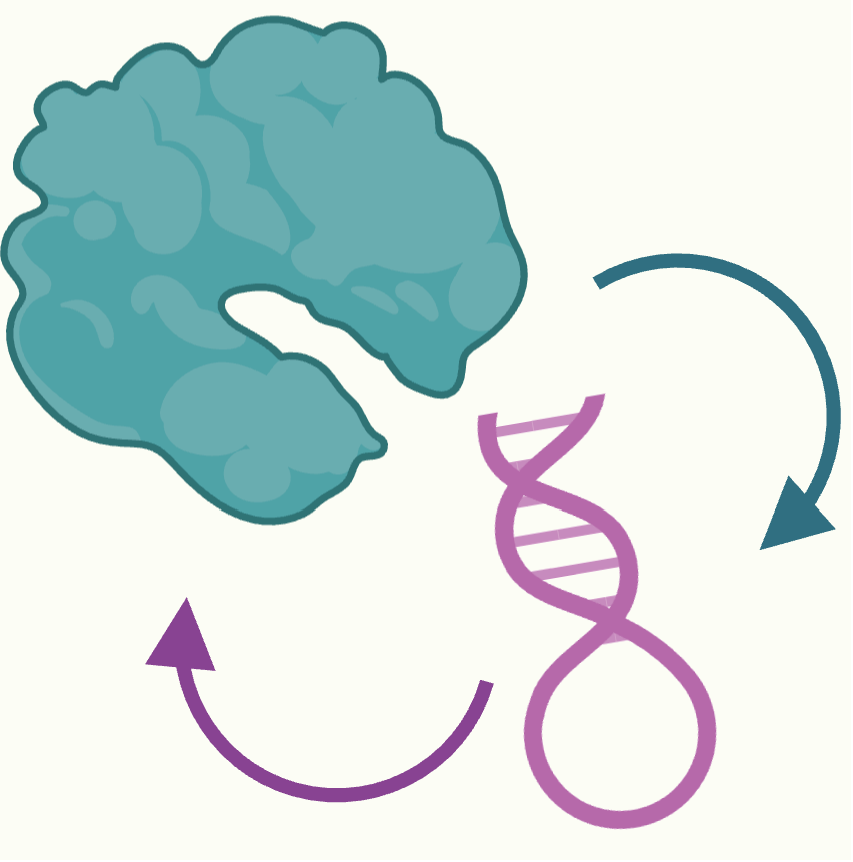

<p align="center">
  
</p>

# RPcontact: RNA-Protein Contact Prediction

**Improved prediction of RNA-protein contacts using RNA and protein language models**

[Paper](https://www.biorxiv.org/content/10.1101/2025.06.02.657171v1.full)
[Code](https://github.com/JulseJiang/RPcontact)

---

## Overview

RPcontact is a computational tool for accurately predicting RNA-protein contacts, addressing a fundamental challenge in understanding molecular biology processes such as transcription, splicing, and translation. Traditional methods are limited by the scarcity of RNA-protein complex structures and the constraints of experimental techniques. While recent deep learning approaches like AlphaFold 3 and RoseTTAFoldNA have made progress, they still rely heavily on homologous templates.

RPcontact overcomes these limitations by leveraging large language models specifically designed for RNA ([ERNIE-RNA](https://github.com/Bruce-ywj/ERNIE-RNA)) and proteins ([ESM-2](https://github.com/facebookresearch/esm)). Trained exclusively on ribosomal RNA-protein complexes, RPcontact delivers robust and generalized performance, accurately predicting contacts in both dimeric and multimeric non-rRNA-protein complexes. Benchmark results show that RPcontact significantly outperforms binary contacts inferred from models like AlphaFold 3 and RoseTTAFoldNA, making it a valuable tool for structure and function prediction in RNA-protein research.

This command-line release provides a simple local inference interface. It supports the embedding-based RPcontact model when precomputed RNA/protein embeddings are available, and also provides a FASTA-only one-hot fallback for quick testing.

---

## Quick Start

### Requirements

| Dependency | Recommended Version |
|------------|---------------------|
| Python | >= 3.8 |
| PyTorch | >= 1.13 |
| NumPy | latest stable |
| pandas | latest stable |
| matplotlib | latest stable |

Install dependencies:

```bash
pip install -r requirements.txt
```

Run the bundled example:

```bash
bash run.sh
```

Or run the same command manually:

```bash
python rpcontact_cli.py \
  -i examples/input.zip \
  -o output \
  --top-k 100
```

The example ZIP contains `pro.fasta`, `rna.fasta`, `pro.npy`, and `rna.npy`, so it runs the embedding checkpoint.
The example is the 2ZZN_D_B complex. Its protein FASTA and one-hot features preserve threonine (`T`).
By default, RPcontact exports the top 100 predicted contact pairs and the full contact probability matrix.

Run the RESM-650M + ESMC-6B input with the same command format:

```bash
python rpcontact_cli.py -i examples/input_resm_esmc.zip -o output_resm_esmc
```

Both ZIPs contain the same four filenames and use automatic checkpoint selection:

| Input | Embeddings | Example pair |
|---|---|---|
| `examples/input.zip` | ERNIE-RNA + ESM-2 | 2ZZN_D_B |
| `examples/input_resm_esmc.zip` | RESM-650M + ESMC-6B | 6ZYM_Y_t (validation pair for workflow checking) |

---

## Input Format

RPcontact CLI accepts either an input directory or a ZIP file.

For RNA, `T` is normalized to `U`. Protein sequences are preserved: protein `T`
(threonine) must not be replaced with `U` (selenocysteine). Generate protein
embeddings from the matching, unchanged protein sequence.

Directory example:

```text
input/
├── pro.fasta
├── rna.fasta
├── pro.npy      # optional
└── rna.npy      # optional
```

ZIP example:

```bash
zip -r input.zip input/
```

The CLI selects the bundled checkpoint from the paired RNA/protein embedding
dimensions. With FASTA files only, it runs the one-hot model. In automatic mode,
incomplete, invalid or unsupported embedding inputs produce an error.

---

## Typical Usage

Run prediction from an input directory:

```bash
python rpcontact_cli.py -i input/ -o output
```

Run prediction from an input ZIP:

```bash
python rpcontact_cli.py -i input.zip -o output
```

Export the top 500 contacts after threshold filtering:

```bash
python rpcontact_cli.py -i input.zip -o output --threshold 0.5 --top-k 500
```

Use GPU:

```bash
python rpcontact_cli.py -i input.zip -o output --device cuda:0
```

Generate a full-resolution heatmap PNG:

```bash
python rpcontact_cli.py -i input.zip -o output --plot-heatmap
```

Keep the NumPy score matrix and diagnostic plots:

```bash
python rpcontact_cli.py -i input.zip -o output --save-npy --plots
```

Heatmap PNG generation is optional. The full article-style score map is always written to `rpcontact_full_map.txt`.

---

## Common Parameters

| Parameter | Description |
|-----------|-------------|
| `-i`, `--input` | Input directory or ZIP containing FASTA files and optional `.npy` embeddings |
| `-o`, `--out-dir` | Output directory |
| `--model` | `auto` (default: infer from embedding dimensions); optionally force `rpcontact` or `resm-esmc6b` |
| `--threshold` | Minimum score for top-contact filtering |
| `--top-k` | Number of top contacts to export |
| `--pro-chunk` | Protein block size for score writing |
| `--rna-chunk` | RNA block size for score writing |
| `--plot-heatmap` | Write a full-resolution contact-map PNG |
| `--save-npy` | Keep `rpcontact_scores.npy` in the output directory and result ZIP |
| `--plots` | Generate diagnostic top-score distribution plots |
| `--device` | Torch device, such as `cpu` or `cuda:0` |

---

## Outputs

Main outputs:

| File | Description |
|------|-------------|
| `rpcontact_full_map.txt` | Article-style contact score matrix with RNA rows and protein columns |
| `rpcontact_top_pairs.csv` | Top contacts ranked by score |
| `rpcontact_summary.json` | Run settings and score summary |
| `rpcontact_results.zip` | Compressed result bundle |

Optional files can be generated with `--save-npy`, `--plots`, and `--plot-heatmap`.

Index note: nucleotide and residue labels use 1-based indexing.


## Embedding Preparation

The bundled example already contains embeddings and can be run immediately.

For new sequences, FASTA files alone are sufficient. To run the embedding-based model, generate `rna.npy` and `pro.npy` with the helper scripts below and place them next to the matching FASTA files.

### RESM-650M + ESMC-6B Checkpoint

The downstream predictor weights are included as
[`models/rpcontact_resm_esmc6b_state_dict.pt`](models/rpcontact_resm_esmc6b_state_dict.pt).
The model was selected from the five cross-validation runs using the highest
validation-fold Global auROC (fold0, epoch13, validation Global auROC 0.855859).
Test results were excluded from selection.

No model configuration file is required. The bundled embedding checkpoints are
selected automatically using both input dimensions:

| RNA embedding channels | Protein embedding channels | Checkpoint |
|---|---|---|
| 768 (772 with one-hot) | 5120 (5140 with one-hot) | ERNIE-RNA + ESM-2 |
| 1280 (1284 with one-hot) | 2560 (2580 with one-hot) | RESM-650M + ESMC-6B |

For your own sequences, supply fixed per-position embeddings from **RESM-650M-KDNY**
for RNA (`rna.npy`: `[RNA length, 1280]`) and **ESMC-6B** for protein (`pro.npy`:
`[protein length, 2560]`). Remove special tokens and retain every sequence position.
The CLI adds RNA/protein one-hot channels, giving 1284/2580 total input channels.
Arrays with one-hot channels already included are also accepted in either
one-hot-first or one-hot-last order. Model selection is automatic; `--model
resm-esmc6b` is available as an optional manual override. Supply embeddings from
the corresponding encoders; matching channel counts alone do not make other
language-model embeddings interchangeable.

These are the trained contact-prediction weights; RNA/protein language-model
embedding extraction is a separate step. The ERNIE-RNA and ESM-2 helper scripts
below are for the default `rpcontact` model.

### RNA Embedding With ERNIE-RNA

This release includes a small ERNIE-RNA helper that reads FASTA records and writes one `.npy` file per RNA sequence:

```text
scripts/extract_rna_embedding.py
```

Copy it into your ERNIE-RNA directory without overwriting ERNIE-RNA's original scripts:

```bash
cp scripts/extract_rna_embedding.py /path/to/ERNIE-RNA/
cd /path/to/ERNIE-RNA

MKL_THREADING_LAYER=GNU python extract_rna_embedding.py \
  --seqs_path /path/to/rna_sequences.fasta \
  --save_path /path/to/input/ \
  --device cpu
```

For a FASTA record named `>RNA_ID`, the script writes:

```text
/path/to/input/RNA_ID.npy
```

Rename or copy the selected RNA embedding to the final RPcontact input name:

```bash
cp /path/to/input/RNA_ID.npy input/rna.npy
```

### Protein Embedding With ESM-2

This release also includes a small ESM-2 helper that runs ESM extraction and writes one `.npy` file per protein sequence:

```text
scripts/extract_pro_embedding.py
```

```bash
python scripts/extract_pro_embedding.py \
  --seqs_path /path/to/protein_sequences.fasta \
  --save_path /path/to/input/ \
  --esm_dir /path/to/esm
```

For a FASTA record named `>PROTEIN_ID`, the script writes:

```text
/path/to/input/PROTEIN_ID.npy
```

Rename or copy the selected protein embedding to the final RPcontact input name:

```bash
cp /path/to/input/PROTEIN_ID.npy input/pro.npy
```

Then run:

```bash
python rpcontact_cli.py -i input/ -o output
```

You can also compress the input directory as shown in the Input Format section.

---

## Training with Alternative Language Models

The [training module](training/README.md) trains the downstream contact predictor
with fixed RNA/protein embeddings. It supports batch sizes greater than 1,
sequence-padding masks in self- and cross-attention, and exclusion of padded or
missing labels (`-999`) from loss and evaluation. Input embedding dimensions are
inferred automatically, allowing either language model to be replaced.

The bundled training example uses **synthetic data**.

**Real data:** [RPcontact on Zenodo](https://doi.org/10.5281/zenodo.20971577)
provides source sequences, contact-distance matrices and dataset metadata/splits.
See the [training data instructions](training/README.md#run-the-bundled-example)
for the files to download and preparation steps.

Run the synthetic example:

```bash
cd training
python -m pip install -r requirements.txt
python prepare_data.py --manifest examples/pairs.tsv --output prepared/example
python train.py \
  --train-data prepared/example/train.pickle \
  --val-data prepared/example/val.pickle \
  --output runs/example \
  --batchsize 2 --max-epochs 2 --device cpu --threads 2
```

See the training README for label formats, custom embeddings, GPU training,
checkpoint selection, and time/memory outputs. Language-model embedding extraction
is a separate step. Training dependencies are listed in `training/requirements.txt`.

---

## Contact & Citation

Questions or suggestions? Contact:

- Jiuhong Jiang
- Email: jiangjh2023@shanghaitech.edu.cn

If you find this project helpful, please cite:

Jiang, J., Zhang, X., Zhan, J., Miao, Z., & Zhou, Y. (2025). RPcontact: Improved prediction of RNA-protein contacts using RNA and protein language models. bioRxiv, 2025-06.

---

<p align="center"><em>Make RNA-protein contact prediction easier and more reproducible.</em></p>
